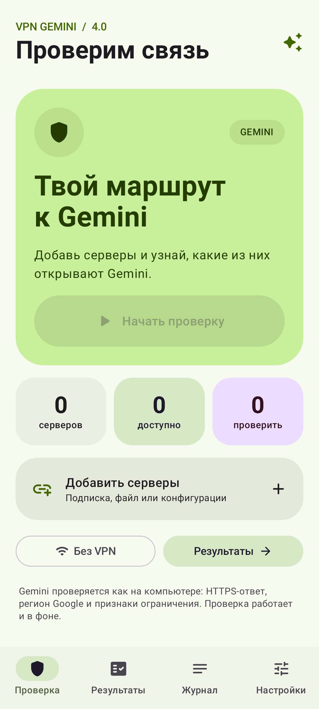
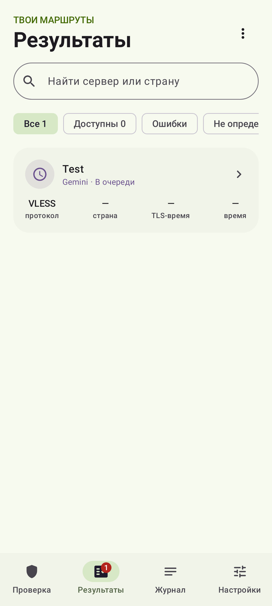
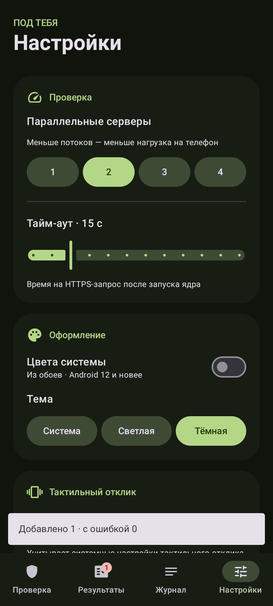
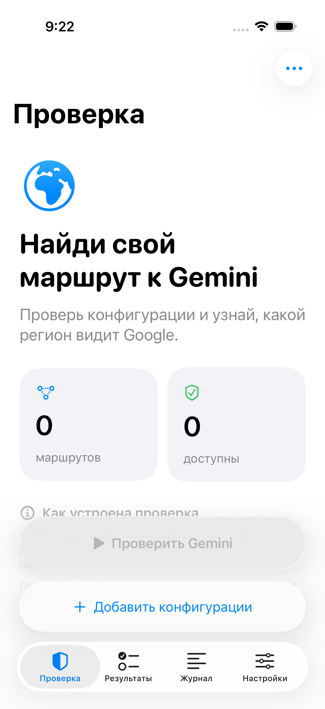
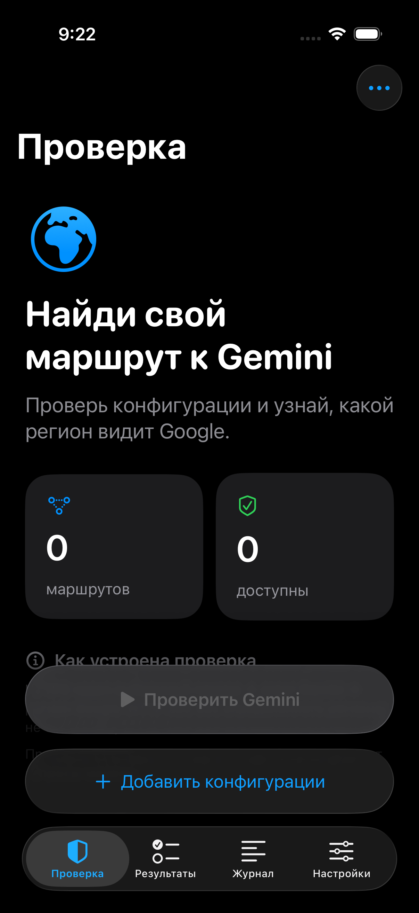
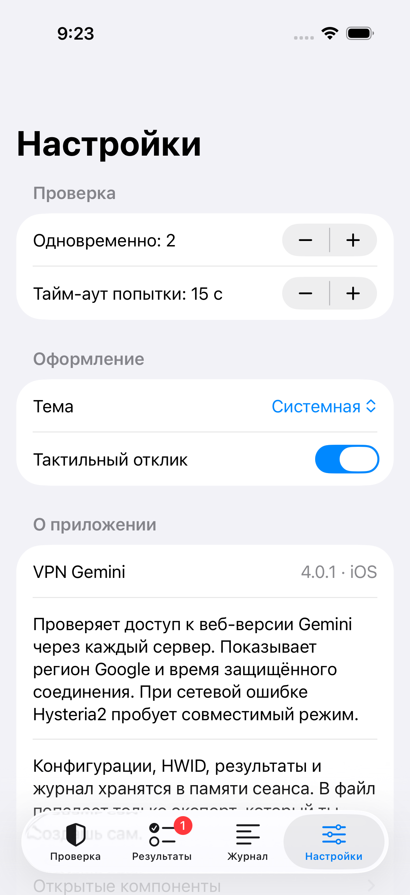
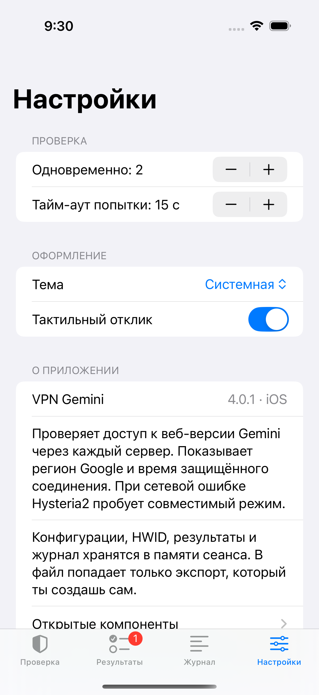
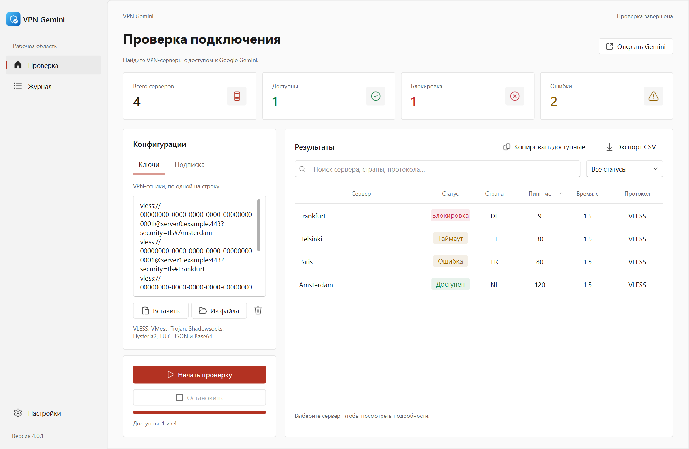
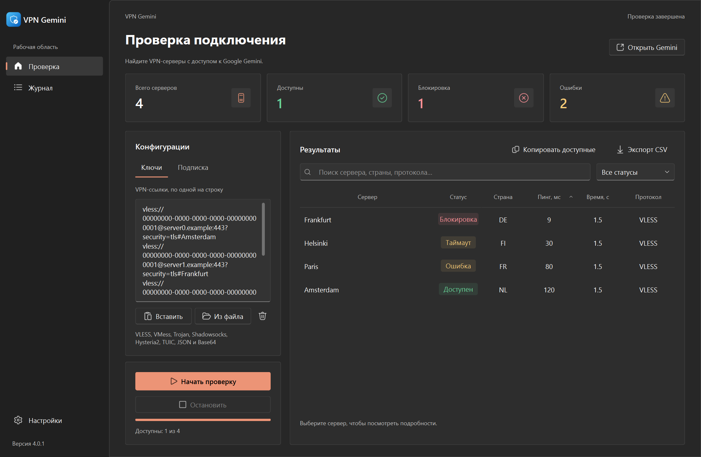

# VPN Gemini

Приложения для Android, iPhone/iPad и Windows для проверки VPN-конфигураций
на доступность Google Gemini.
Добавьте подписку, файл или отдельные конфигурации, запустите проверку и
выберите подходящий сервер по результатам.

## Возможности

- Импорт HTTPS-подписок, ссылок, Base64 и JSON; добавление конфигураций из файла.
- VLESS, VMess, Trojan, Shadowsocks, Hysteria2 и TUIC.
- Проверка ответа Gemini и региона Google через каждый сервер.
- HTTP-статус, время TLS-соединения и общая длительность проверки.
- Поиск, фильтры, сортировка, журнал, копирование конфигураций и экспорт CSV.
- Необязательный HWID и его генерация для совместимых подписок.
- Интерфейс Material 3 Expressive, системные цвета Android 12+,
  светлая и тёмная темы, анимации и тактильный отклик.

## Как проходит проверка

Приложение запускает Xray или sing-box для выбранной конфигурации и отправляет
HTTPS-запрос к Gemini через созданный туннель. Доступность определяется по
ответу сервиса, региону Google и признакам ограничения.

Один только HTTP 200 не считается подтверждением доступности. Если данных
недостаточно, результат отображается как «Не определён». При ошибке туннеля
прямое подключение вместо него не используется.

Проверка не выполняет вход в аккаунт Google и не отправляет запросы генерации
модели. Её результат не гарантирует доступ для конкретного аккаунта.

## Платформы и установка

| Платформа | Версия | Дизайн | Скачать |
| --- | --- | --- | --- |
| Android 8.0+, ARMv7 / ARM64 / x86_64 | 4.0.7 | Material 3 Expressive | [APK и исходники](https://github.com/fodis3/VPN-Gemini-test/releases/tag/v4.0.7) |
| iPhone / iPad, iOS 17+ | 4.0.1 | SwiftUI; Liquid Glass на iOS 26 | [IPA и исходники](https://github.com/fodis3/VPN-Gemini-test/releases/tag/ios-v4.0.1) |
| Windows x86 / x64 | 4.0.1 | Fluent Design, PySide6 | [EXE и исходники](https://github.com/fodis3/VPN-Gemini-test/releases/tag/windows-v4.0.1) |

**Android:** выберите APK по архитектуре: `armeabi-v7a` для 32-битных ARM,
`arm64-v8a` для 64-битных ARM, `x86_64` для Intel/AMD.
Сборки подписаны одним постоянным ключом выпуска.
Переход с debug-сборки 4.0.5 требует удаления прежней установки.

**iPhone / iPad:** IPA не подписан. Для установки потребуется подпись вашим
сертификатом Apple или самостоятельная переподпись. Это не готовая публикация
в App Store. Сборка выполняется на macOS через GitHub Actions.
На iOS 17–18 используется стандартный системный интерфейс, на iOS 26 — Liquid Glass.
При сворачивании приложения iOS активная очередь проверок останавливается.

**Windows:** скачайте и запустите EXE; Python, Qt и отдельная установка ядер
не требуются. Для 32-битной Windows выбирайте файл `x86`, для 64-битной — `x64`.
EXE не подписан сертификатом издателя. В x86 используется Qt 5.15, в x64 — Qt 6.

У платформ независимые версии и интерфейсы; набор отдельных функций отличается.
Во всех клиентах проверяется ответ Gemini через конфигурацию сервера.
Приложения не предоставляют собственные VPN-серверы или подписки.

## Данные Android

Конфигурации, ссылка подписки, HWID и результаты хранятся в памяти текущего
сеанса. Настройки сохраняются между запусками. Временные конфигурации ядер
размещаются в приватном кэше приложения и удаляются после проверки;
остатки после аварийного завершения очищаются при следующем запуске.
Экспорт результатов выполняется по команде пользователя.

## Исходники и сборка

- **Android:** проект в корне репозитория; Kotlin, Jetpack Compose.
  [Сборка и подпись](docs/BUILDING.md).
- **iOS:** каталог [`ios/`](ios), SwiftUI и единый Go-модуль с Xray / sing-box.
  [Документация](ios/README.md), [проверка сборки](ios/VERIFICATION.md).
  [Отдельный репозиторий со сборкой GitHub Actions](https://github.com/fodis3/test-vpn-ios).
- **Windows:** каталог [`windows/`](windows), Python, PySide6 / PySide2.
  [Сборка и запуск](windows/README.md).

## Лицензия

Собственный код проекта: **GPL-3.0-or-later** — см. [LICENSE](LICENSE)
и [уведомление](COPYING-NOTICE.txt).
Сторонние компоненты сохраняют свои лицензии:
Xray — MPL-2.0, sing-box — GPL-3.0-or-later,
AndroidX, Kotlin и OkHttp — Apache-2.0.
[Лицензии и ссылки на исходники компонентов](app/src/main/assets/licenses).

Независимый проект, не связанный с Google. Gemini — продукт Google.

## Скриншоты

### Android · Material 3 Expressive

  
  
  

### iPhone · iOS 26 · Liquid Glass

  
  
  

### iPhone · iOS 18.5

  
  
  

### Windows · Fluent Design

Это снимки интерфейса из проверок Compose/Qt и симулятора iOS.
Серверы и результаты на демонстрационных экранах — тестовые данные.
