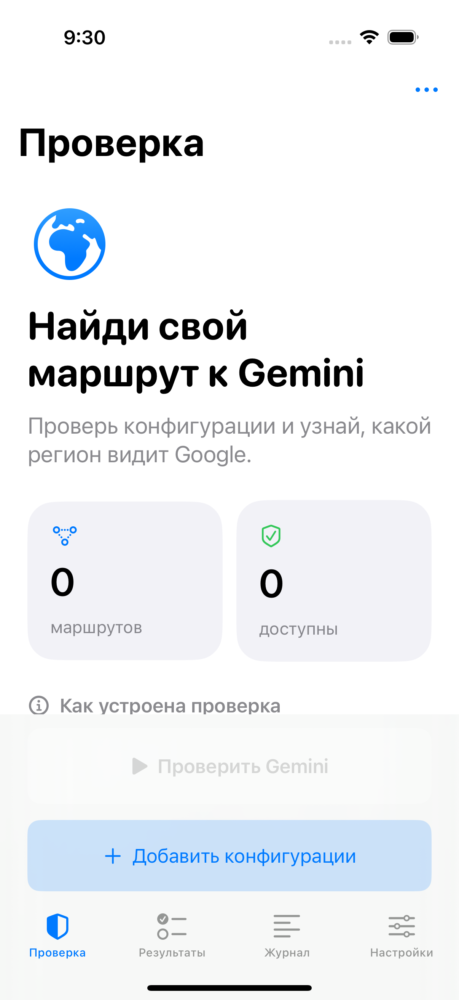
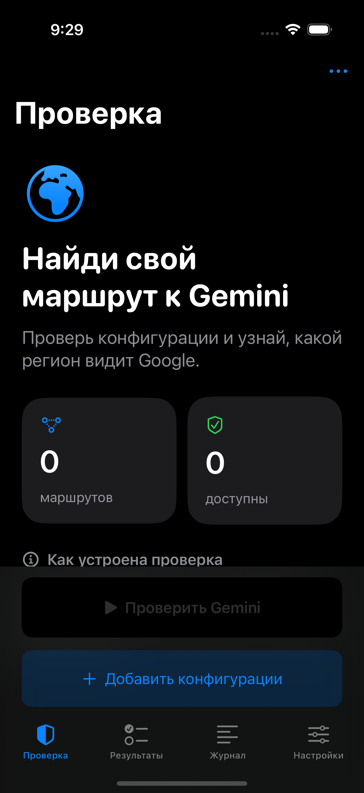

# VPN Gemini для iOS

Нативное приложение для iPhone и iPad, iOS 17+, SwiftUI; **Liquid Glass** на iOS 26 и стандартное оформление на iOS 17–18.
Логика проверки перенесена из настольного клиента и Android 4.0.5.

## Дизайн

Изучены официальные материалы Apple до реализации:

- [Adopting Liquid Glass](https://developer.apple.com/documentation/TechnologyOverviews/adopting-liquid-glass)
- [Applying Liquid Glass to custom views](https://developer.apple.com/documentation/swiftui/applying-liquid-glass-to-custom-views)
- [Build a SwiftUI app with the new design](https://developer.apple.com/videos/play/wwdc2025/323/)

Стекло используется для навигации и действий: стандартный `TabView`,
`NavigationStack`, toolbar, системные sheets, `GlassEffectContainer`,
кнопки `.glass` и `.glassProminent`. Информационные карточки имеют читаемый
фон, без наложения нескольких стеклянных слоёв. Используются SF Symbols,
системные цвета, Dynamic Type, светлая/тёмная тема, системная адаптация
прозрачности и Reduce Motion, отключаемый мягкий тактильный отклик.
Поля ввода в Form следуют safe area клавиатуры; её можно скрыть кнопкой
«Готово» или интерактивным прокручиванием.

## Как проверяется Gemini

Xray / sing-box → настоящий HTTPS `https://gemini.google.com/app` →
`WIZ_global_data.vXmutd` → регион Google и явные признаки ограничения.
Обрабатывается сериализованный формат `%.@.\"US\",...`, а не случайные
двухбуквенные строки из соседних полей. HTML и HTTP 200 без региона не
считаются успехом. Вход, CAPTCHA, ограничение региона, HTTP 429, ошибки
и тайм-ауты различаются. TLS-сертификат Gemini проверяется штатно.

Региональные правила соответствуют Android 4.0.5 и справке Google,
проверенной 20.10.2026: AF/BY/CU/IR/KP/RU/SY отсутствуют в списке,
CN указан как Workspace only. Список следует обновлять при изменениях
[доступности веб-версии](https://support.google.com/gemini/answer/13575153?hl=en).
Аккаунт Google и генерация ответа модели не проверяются.

TLS-время измеряется до успешного завершения TLS к Gemini, включая
установление удалённого туннеля. Локальный SOCKS ACK и TCP-пинг не
заменяют проверку. Прямого подключения при ошибке прокси нет.

При транспортном тайм-ауте или EMSGSIZE / `message too long` Hysteria2
повторяется один раз с `initial_packet_size=1200`,
`disable_path_mtu_discovery=true`, `disable_chrome_parrot=true`.
Статус зависит только от фактического ответа повторной проверки.

## Архитектура

`engine/` — единая Go-библиотека с Xray **26.3.27** и sing-box **1.14.3**.
Оба ядра компилируются одним `gomobile bind` и используют **один Go runtime**.
Две независимо собранные Go-библиотеки не линкуются.
На iOS нет запуска скачанных executable и нет временных файлов с ключами.
HTTP transport использует dialer выбранного ядра непосредственно, без
промежуточного локального SOCKS-порта. Обе стороны используют ту же схему
проверки и параметры outbound, что Android; iOS-транспорт адаптирован к API
библиотек. Для sing-box адрес VPN-сервера разрешается системным resolver,
с сохранением SNI. Native bridge передаёт UTF-8 JSON.

Проверка касается только запросов приложения. Network Extension,
общесистемный VPN, root и VPN entitlements не требуются.
**Фоновая проверка не обещается:** при сворачивании iOS-приложения очередь
останавливается; все активные запросы отменяются.

Поддерживаются VLESS / VMess / Trojan / Shadowsocks, REALITY, TLS, gRPC,
WebSocket, XHTTP, HTTPUpgrade, а также Hysteria2 / TUIC. JSON outbound
сохраняется. Записи с неподдерживаемыми протоколами, ошибки и дубликаты
не удаляются при импорте. Связанные selector/urltest-профили требуют
зависимостей полного профиля и показывают объяснение.

## Возможности

- Подписки HTTPS, текст, Base64 и JSON, импорт файлов до 8 МБ.
- Необязательный HWID и UUID4-генератор; совместимые `x-hwid` и User-Agent.
- Понятные ошибки поставщика / Cloudflare 1002; форма сохраняется при ошибке.
- Параллельность 1–4, тайм-аут, остановка, проверка текущего соединения.
- Поиск, фильтры, сортировка, подробности ответа, журнал, CSV и копирование.
- Конфигурации, HWID, результаты и журнал остаются в памяти сеанса.
  Сохраняются только настройки; экспорт создаётся по команде пользователя.
  Прочитанные из буфера данные не отправляются куда-либо без импорта.
- В репозитории нет реальных подписок, UUID пользователей или паролей серверов.

## Сборка IPA через GitHub Actions

Workflow `.github/workflows/ios.yml` запускается при push в `main`
или вручную: **Actions → Build iOS IPA → Run workflow**.
На macOS 26 он проверяет Go-код, создаёт `GeminiCore.xcframework`,
генерирует Xcode-проект, собирает архив и IPA, затем запускает UI-тесты
на iOS Simulator и сохраняет снимки интерфейса.

Артефакт **VPN-Gemini-iOS-4.0.1** содержит:

- `VPN-Gemini-iOS-4.0.1-unsigned.ipa` — для самостоятельной переподписи;
- результаты UI-тестов и скриншоты;
- подписанный IPA, если выбран signed и заданы Apple secrets.

**Unsigned IPA сам по себе не устанавливается на iPhone.** GitHub собирает
код, но не выдаёт подпись Apple. Можно переподписать IPA своим способом
установки или использовать собственный сертификат и профиль.
Для [официального распространения](https://developer.apple.com/documentation/xcode/distributing-your-app-for-beta-testing-and-releases)
через TestFlight/App Store требуется Apple Developer Program.

Для optional signing в Settings → Secrets and variables → Actions:

| Secret | Значение |
|---|---|
| `APPLE_CERTIFICATE_BASE64` | PKCS#12 сертификат с private key в Base64 |
| `APPLE_CERTIFICATE_PASSWORD` | Пароль PKCS#12 |
| `APPLE_PROFILE_BASE64` | Provisioning profile в Base64 для `ru.vpngemini.ios` |
| `APPLE_TEAM_ID` | Team ID Apple |

Используется профиль debugging / release-testing с зарегистрированным
устройством. Секреты не нужно присылать в чат или коммитить в репозиторий.

## Локальная сборка на Mac

Нужны Xcode с iOS 26 SDK и iOS Simulator, Go 1.26.8, Python 3 и XcodeGen.

```sh
cd engine
go test -tags=with_quic,with_utls ./...
cd ..
bash scripts/build-core.sh
xcodegen generate
open VPNGemini.xcodeproj
```

Выбрать свой Team и устройство в Xcode. Для простого тестера Network Extension
не добавлять. `engine/go.mod` и `go.sum` фиксируют версии зависимостей.
Официальные исходники ядер доступны по ссылкам из `App/NOTICES.txt`.

## Проверки

Unit-тесты: форматы vXmutd, страны с противоположным результатом при HTTP 200,
вход/CAPTCHA/429, TLS-проверка и измерение, импорт 80 записей с ошибками,
дубликаты, кодировки паролей, gRPC, QUIC retry profile и отмена.
Опциональный `VPN_GEMINI_LIVE_CASES` позволяет передать временные тестовые
конфигурации через окружение; без него сетевой тест пропускается.
UI-тесты проверяют импорт, вкладки, настройки и генерацию HWID.

Проверенная сборка 4.0.1 (40000):
[GitHub Actions](https://github.com/fodis3/test-vpn-ios/actions/runs/39403513109).
В симуляторе также запускается настоящий probe через закрытый VPN-порт:
результат должен быть ошибкой, без прямого обхода прокси.
Проверены светлая и принудительно включённая тёмная темы.
См. [отчёт](VERIFICATION.md) и [снимки интерфейса](preview/).

Лицензия приложения: GPL-3.0-or-later. Сохраняются MPL/BSD/другие лицензии
зависимостей. Подготовленная сборка для личного тестирования не означает
автоматическое соответствие требованиям публикации в App Store.

## Совместимость интерфейса

Минимальная версия системы — iOS 17.0, включая Go-фреймворк ядер.
На iOS 26 используются Liquid Glass, стеклянные кнопки и системная нижняя
панель. На iOS 17–18 — стандартная панель вкладок, кнопки SwiftUI bordered
и borderedProminent, нижняя панель с системным материалом.
Импорт, настройки, проверка Gemini и экспорт используют общий код.

Скриншоты реального симулятора iOS 18.5:

<p></p>
